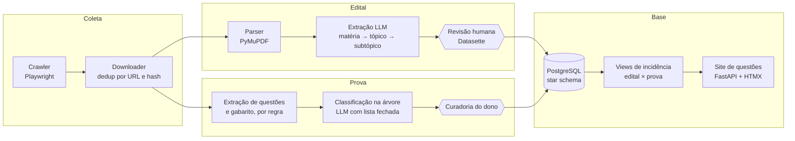

# Scraper CEBRASPE

**Liga cada item de um edital de concurso às questões que a banca realmente cobrou, e mede quanto de uma prova cada assunto representa.**

[](https://athosroque.github.io/scraper-cebraspe/)
[](https://www.python.org/)
[](https://www.postgresql.org/)

---

## O problema

Quem estuda para um concurso do CEBRASPE abre um edital com centenas de itens e não tem como saber quais deles caem de verdade. As provas anteriores existem, mas em PDF, sem nenhuma ligação com o item do edital a que se referem. O candidato resolve questões soltas sem saber se o assunto é recorrente, se o edital o cobra, ou quanto da prova ele representa.

Este projeto desfaz esse nó. Um exemplo real, lido do banco:

> No edital do **STM 2025**, o cargo de Analista Judiciário – Área Administrativa traz o bloco **"Licitações e contratos administrativos"**, com 14 itens, dentro de uma lista de 53 blocos. Esses itens apontam para o nó `Direito Administrativo › Contratos administrativos › Lei nº 14.133/2021` da árvore de assuntos. Na prova, esse nó respondeu por **11 das 68 questões do cargo — 16,2%**, o assunto mais cobrado.

Essa frase não foi escrita à mão: ela é o resultado de uma consulta a views do banco, e qualquer item de qualquer edital carregado produz a sua.

## Números

Da base em 17/11/2026, gerados por `scripts/gerar_numeros.py` direto do Postgres.

| | |
|---|---:|
| Concursos no inventário (2020–2026) | 346 |
| Concursos carregados e aprovados | 7 |
| Cargos de edital · cadernos de prova | 41 · 87 |
| Questões extraídas | 3.410 |
| Certo ou errado · múltipla escolha | 2.800 · 610 |
| Itens de edital · subitens | 1.812 · 3.992 |
| Nós da árvore (matéria · assunto · subassunto) | 44 · 699 · 2.048 |
| Apontamentos questão → árvore | 3.603 |
| **Custo acumulado de LLM, desde o início** | **US$ 0,39** |

O custo é baixo de propósito: o modelo de linguagem só é chamado onde o julgamento é inevitável — ler a lista de conteúdos de um edital e sugerir onde uma questão se encaixa na árvore. Ler a prova, separar as questões, casar o gabarito e calcular a incidência é tudo determinístico, por regra, sem token nenhum.

## Como funciona



Os losangos são portões humanos: nada que um modelo propôs entra na base sem aprovação registrada. A unidade que costura tudo é a **árvore mestre de assuntos** — um nó por conceito, com matéria, assunto e subassunto. Item de edital e questão apontam para nós, numa relação N:N, e é dessa ligação que saem todas as estatísticas.

Desenho completo, com os contratos de cada etapa: [Arquitetura](https://athosroque.github.io/scraper-cebraspe/executivo/arquitetura/).

## O que este repositório demonstra

- **Pipeline de dados de ponta a ponta**, do HTML da banca até views consultáveis: coleta idempotente, validação binária dos PDFs, desduplicação em duas camadas, carga que pode rodar de novo sem duplicar nada, orquestração em Dagster com *asset checks*.
- **LLM sob governança.** O modelo propõe, a pessoa decide. Toda chamada tem trilha de auditoria em disco, telemetria no Langfuse, classificação explícita de falha (timeout, rate limit, schema inválido) e lista fechada de saída validada por Pydantic. Um invariante de regressão (K22) trava qualquer lote que altere o piloto já aprovado.
- **Modelagem dimensional**, com *star schema*, chave natural normalizada e incidência calculada em dois níveis — prova e concurso — para que um caderno básico compartilhado entre cargos não seja contado várias vezes.
- **Documentação como parte do produto.** 97 páginas publicadas, com as páginas técnicas **geradas do código**: um registro em `src/registro/` descreve scripts, etapas, checagens e regras, e um teste recusa o commit se a página gerada divergir da fonte.
- **Decisões registradas.** [45 ADRs](https://athosroque.github.io/scraper-cebraspe/adr/) explicam por que cada escolha foi feita e o que foi descartado, com data e status.
- **Rastreabilidade de processo.** Cada etapa é um card no Jira, cada commit cita o card, cada decisão cita o ADR. 1.906 testes automatizados, agrupados por etapa do pipeline.

## Documentação

| | |
|---|---|
| [Site de documentação](https://athosroque.github.io/scraper-cebraspe/) | Visão executiva, guia técnico, decisões e páginas geradas do código |
| [Visão executiva em PDF](https://athosroque.github.io/scraper-cebraspe/executivo/scraper-cebraspe-executivo.pdf) | O projeto em 20 páginas, para ler fora do navegador |
| [Catálogo de ADRs](docs/adr/README.md) | As 45 decisões, por tema |
| [Números](https://athosroque.github.io/scraper-cebraspe/executivo/numeros/) | Cobertura, questões, árvore e custo, lidos do banco |
| [`CLAUDE.md`](CLAUDE.md) · [`task.md`](task.md) | Contexto operacional e roteiro por etapas — o método de trabalho, aberto |
| [`LESSONS.md`](LESSONS.md) | Post-mortems de bugs reais de scraping e de comportamento de modelo |

## Rodando localmente

Requer Python 3.11+, Docker e Docker Compose.

```bash
git clone https://github.com/athosroque/scraper-cebraspe.git
cd scraper-cebraspe

python3 -m venv venv && source venv/bin/activate
pip install -r requirements.txt
playwright install chromium

cp .env.example .env     # preencher POSTGRES_PASSWORD e a chave do OpenRouter
docker compose up -d scraper-cebraspe-db
```

A partir daí:

```bash
python -m src.spider                      # coleta os concursos do ano configurado
python -m scripts.revisar_taxonomia_piloto # extrai a taxonomia dos editais e monta a revisão
make test-all                             # 1.906 testes
make docs-serve                           # documentação em 127.0.0.1:8001
```

O comando de cada script, com os argumentos, está em [Comandos](https://athosroque.github.io/scraper-cebraspe/tecnico/comandos/). Para entender o pipeline antes de rodar, comece por [Começando](https://athosroque.github.io/scraper-cebraspe/guia/comecando/).

## O que não está neste repositório

Omissões deliberadas, não esquecimentos:

- **Os PDFs baixados** (`data/`) e **o texto das questões** (`questoes/`). O conteúdo das provas é da banca; o repositório guarda só o que é derivado e próprio — a árvore de assuntos, a classificação (por *hash* do enunciado, nunca pelo texto) e as estatísticas.
- **Credenciais.** Tudo vem de `.env`, que está no `.gitignore`. O `.env.example` lista as variáveis sem valor.
- **Os logs** (`logs/`) e os artefatos regeneráveis (`build/`, `revisao.db`).

## Licença

Código e documentação de autoria de Athos Roque, publicados para leitura e avaliação. Os editais, provas e gabaritos são documentos do CEBRASPE e dos órgãos contratantes, e não são redistribuídos aqui.
