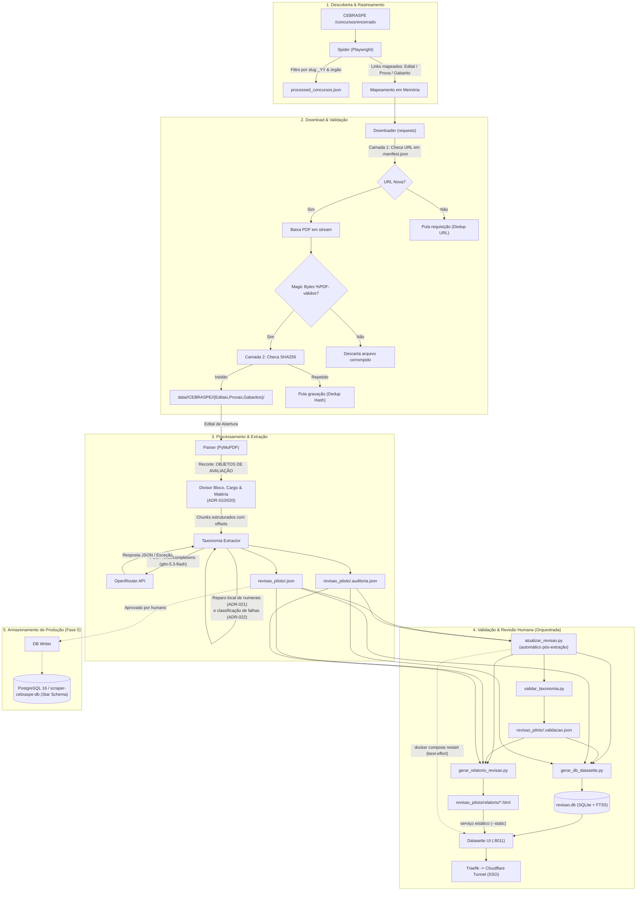

# Arquitetura do Sistema — Scraper CEBRASPE

Este documento detalha o desenho arquitetural, os componentes e o pipeline de processamento do **Scraper CEBRASPE**, responsável pela coleta, download, extração de conteúdo programático e estruturação taxonômica de concursos públicos organizados pelo CEBRASPE.

---

## 1. Visão Geral

O sistema é concebido como um pipeline batch desacoplado em etapas autônomas. Ele se integra ao ecossistema do **Homelab**, reutilizando serviços centrais de infraestrutura:
- **OpenRouter & Langfuse**: Provedor de inferência para o modelo `z-ai/glm-5.3-flash` consumido diretamente via REST, com observabilidade e telemetria via SDK oficial do Langfuse (OTel, ver ADR-023).
- **PostgreSQL 16 próprio** (`scraper-cebraspe-db`, `docker-compose.yml` deste projeto, porta `127.0.0.1:5435` ou rede `homelab_default:5432`). Independente do `study-rag-agent`; o cruzamento com `itens_estudo` é uma etapa futura via tabela de mapeamento + `postgres_fdw` (ADR-026).
- **Traefik + Cloudflare Tunnel**: Roteamento reverso e proteção por Single Sign-On (Cloudflare Access) para ferramentas internas.

---

## 2. Diagrama do Pipeline



---

## 3. Componentes Principais

### 3.1. Crawler & Descoberta (`src/spider.py`)
- **Ponto de entrada:** Página `/concursos/encerrado` do CEBRASPE (contém histórico mais rico de provas e gabaritos).
- **Resolução de Hrefs:** URLs dos cards são resolvidas via `urljoin(page.url, href)` para prevenir falhas silenciosas com links relativos.
- **Extração por Slug:** O ano e o órgão do concurso são obtidos diretamente dos segmentos do slug (ex: `PF_25_ADM` → órgão `PF`, ano `2025`), contornando o fato de o texto visível de todos os links ser genérico ("MAIS INFORMAÇÕES").
- **Idempotência:** Concursos processados com sucesso são gravados em `data/processed_concursos.json` apenas após a conclusão bem-sucedida do download de seus arquivos.

### 3.2. Downloader com Duplo Dedup (`src/downloader.py`)
- **Validação de Integridade:** Valida não apenas o header `Content-Type`, mas verifica obrigatoriamente os magic bytes `%PDF-` nos primeiros 4 bytes do arquivo, descartando respostas HTTP 200 que contêm páginas de erro HTML.
- **Desduplicação em 2 Níveis:**
  1. *Camada 1 (Rede):* Manifesto `.manifest.json` mapeia URL já baixada, evitando requisições HTTP redundantes.
  2. *Camada 2 (Armazenamento):* Hash SHA256 do binário evita armazenar cópias idênticas sob URLs diferentes (como retificações repetidas).
- **Estrutura no Disco:**
  ```text
  data/
  └── <ano>/
      └── CEBRASPE/
          └── <orgao_slug>/
              ├── .manifest.json
              ├── Editais/
              ├── Provas/
              ├── Gabaritos/
              └── provas_texto_link.json
  ```

### 3.3. Parser de Editais (`src/edital_parser.py`)
- **Extração Seletiva:** Foca estritamente na seção de conteúdo de estudo: `"OBJETOS DE AVALIAÇÃO (HABILIDADES E CONHECIMENTOS)"`.
- **Chunking Hierárquico (Cargo + Matéria):** Suporta tanto cargos administrativos (com várias matérias associadas) quanto cargos de especialidade (onde o cabeçalho do próprio cargo atua como tema/disciplina).
- **Classificação por Bloco (ADR-020):** Cabeçalhos `CONHECIMENTOS BÁSICOS/ESPECÍFICOS PARA ... NÍVEL SUPERIOR/MÉDIO` definem `tipo_conhecimento` e `nivel` de cada chunk, junto com `cargo_numero`, `materia_normalizada` e `apenas_discursiva`. O concurso (`slug`/`orgao`/`ano`) vem do manifesto do downloader. Extrações antigas são completadas sem LLM por `scripts/backfill_classificacao_chunks.py`.
- **Detecção de Layout e Limpeza:** Identifica blocos de múltiplas colunas via PyMuPDF e filtra ruídos editoriais (ex: notas de retificação intercaladas no texto).

### 3.4. Extrator de Taxonomia via LLM (`src/taxonomia_extractor.py`)
- **Conexão Direta:** Comunicação via HTTP client (`requests`) direto com o OpenRouter REST API, mantendo as dependências enxutas sem a necessidade de SDKs pesados.
- **Isolamento de Chaves e SDK Oficial:** Chave de API dedicada do OpenRouter e projeto dedicado no Langfuse, com telemetria via SDK oficial (OTel, ADR-023).
- **Robustez na Inferência:**
  - Extração padrão com `MAX_TOKENS = 12000`, `REQUEST_TIMEOUT = 120s` e `reasoning = {"max_tokens": 3000}` em `taxonomia_extractor.py`.
  - Reprocessamento direcionado com contexto estendido (`max_tokens = 24576`, `timeout = 240s`) em `scripts/reprocessar_falhas_piloto.py`.
  - Retry exponencial com backoff (`TENTATIVAS_PADRAO = 2`, backoff de 5 a 15 segundos).
- **Reparo Local Determinístico (ADR-021):**
  - Identifica tópicos cujo `nome` foi preenchido pelo LLM apenas com o numeral do item ("1", "2", ...).
  - Em vez de realizar um retry cego (que consome tokens sem garantia de correção e sem rastro próprio), busca o texto real do tópico diretamente do texto-fonte usando `extrair_itens_numerados(chunk_text)` de `src/edital_parser.py`.
  - Zero custo em tokens. Log estruturado com tag `[REPARO_NOME_NUMERICO]` e envio de metadados `reparo_nome_numerico` ao Langfuse.
  - Se algum numeral não puder ser mapeado no texto-fonte, devolve status específico `STATUS_FALHA_NOME_NUMERICO_NAO_MAPEADO = "falha_nome_numerico_nao_mapeado"` para sinalizar falha semântica de mapeamento em vez de falha técnica transitória.
- **Classificação Granular de Erros (ADR-022):**
  - Mapeamento explícito das exceções de rede, HTTP e parsing em status granulares:
    - `falha_timeout`: `requests.exceptions.Timeout`
    - `falha_conexao`: `requests.exceptions.ConnectionError`
    - `falha_rate_limit`: `HTTPError` com status code 429
    - `falha_http`: `HTTPError` com qualquer outro status code (4xx/5xx)
    - `falha_rede`: outras `requests.RequestException`
    - `falha_conteudo_vazio`: resposta sem `content` (truncamento por tokens)
    - `falha_parse_json`: `json.JSONDecodeError`
    - `falha_validacao_schema`: `pydantic.ValidationError`
  - Centralização de telemetria via função `_falha_chamada` com logs com tags greppáveis `[FALHA_*]` e registro de `metadata["tipo_erro"]` no Langfuse via SDK oficial (ADR-023).
- **Trilha de Auditoria:** Cada extração gera o par `<edital>.json` (taxonomia) e `<edital>.auditoria.json` (offsets do PDF, texto exato enviado ao modelo e status tipado de cada chunk).

### 3.5. Validação Heurística e Revisão Humana
- **Orquestração Automática de Artefatos (`scripts/atualizar_revisao.py` — ADR-019):**
  - Encapsula em cadeia: `validar_taxonomia` → `gerar_relatorios` → `gerar_db` → restart do contêiner Datasette.
  - Invocado automaticamente ao término de `revisar_taxonomia_piloto.py` (toda nova extração) e de `reprocessar_falhas_piloto.py` (ao obter novos sucessos).
  - Execução de restart *best-effort*: se o Docker local estiver inativo ou indisponível, emite aviso sem interromper a execução nem falhar o pipeline de extração que já concluiu o salvamento dos JSONs.
  - Opera também como comando manual CLI (`python -m scripts.atualizar_revisao`) para reconstrução dos artefatos após edição direta de arquivos JSON.
- **Validação Heurística De-Para (`scripts/validar_taxonomia.py` — ADR-017):**
  - Compara, por chunk, os itens de primeiro nível do texto-fonte (`texto_enviado_llm` em `.auditoria.json`) contra os tópicos extraídos pelo LLM (`topico["nome"]` em `.json`), gerando `<edital>.validacao.json`.
  - Classifica divergências em cinco alertas: `topico_ausente` (item da fonte esquecido pelo modelo), `topico_extra` (tópico alucinado ou consolidado), `chunk_sem_extracao` (falhas de inferência), `chunk_sem_classificacao` (chunk sem nível/tipo de conhecimento, fora dos filtros; ADR-020) e `topico_nome_numerico` (tópico com numeral que escapou ao reparo ou pré-data a correção; ADR-021).
  - Normalização Unicode-aware e casamento por substring para prevenir falsos positivos com hifens tipográficos e sufixos de leis.
- **Relatório Estático Lado a Lado (`scripts/gerar_relatorio_revisao.py` — ADR-018):**
  - Produz páginas HTML de página única (`revisao_piloto/relatorio/<edital>.html` e `index.html`) sem dependências externas (stdlib pura).
  - Apresenta layout em duas colunas: texto-fonte do edital com marcações `<mark>` para tópicos ausentes à esquerda e árvore taxonômica à direita.
- **Banco e Visualização Unificada (`scripts/gerar_db_datasette.py` — ADR-015/018/020):**
  - Constrói o banco SQLite descartável `revisao_piloto/revisao.db` com busca Full-Text Search (FTS5), tabela `alertas_validacao` e tabela `cargos`. `taxonomia_topicos` é filtrável por concurso, nível e tipo de conhecimento (ADR-020).
  - Servido via contêiner oficial Datasette (`docker-compose.yml`), expondo busca SQL em tabelas relacionais e os relatórios estáticos (`--static relatorio:/data/relatorio`), protegido por Traefik e Cloudflare Access.

### 3.6. Bot de Notificações e Interações (Telegram — `src/telegram_bot.py`)
- **Canal de Interação:** Bot assíncrono para notificações de status do pipeline e consultas contextuais.
- **Integração com LLM e Observabilidade:** Conexão REST direta com OpenRouter utilizando chave dedicada (`OPENROUTER_KEY_TELEGRAM`) e observabilidade no Langfuse via SDK oficial (OTel, ADR-023), no mesmo projeto do pipeline, com trace `cebraspe-telegram-bot`.
- **Segurança de Acesso:** Verificação de ID do remetente via `TELEGRAM_ALLOWED_USER_ID`, descartando mensagens de usuários não autorizados.

---

## 4. Segurança e Isolamento

1. **Credenciais:** Chaves de API e conexões com banco residem exclusivamente no `.env` (gitignored). Chaves dedicadas para cada serviço (Telegram Bot e Taxonomia Extractor).
2. **Exposição de Rede:** O serviço Datasette é restrito à rede interna do Docker (`homelab_default`) e a política do Cloudflare Tunnel restringe o acesso via autenticação corporativa (SSO por email).
3. **Limitação de Taxa e Stealth:** O crawler Playwright aplica tempos de espera randômicos e headers reais de navegador para evitar sobrecarga ou bloqueio pelo portal CEBRASPE.
