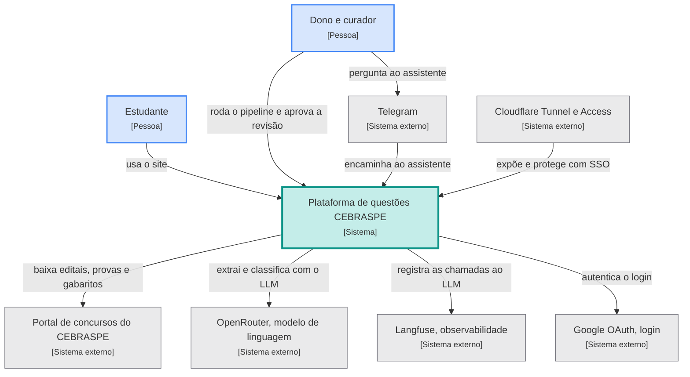
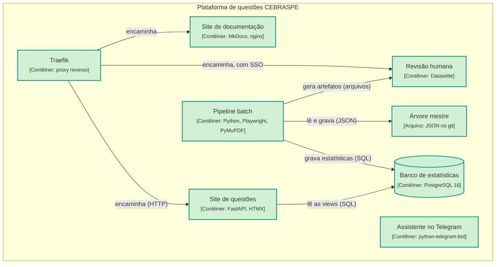

# Arquitetura

Como o sistema se divide em partes e com quem ele conversa.

O modelo C4 descreve a arquitetura em quatro níveis: contexto, contêineres, componentes e código. Esta página mostra os dois primeiros. O detalhe técnico está no [guia técnico do pipeline](../tecnico/pipeline.md) e na [arquitetura detalhada](../architecture.md).

## Nível 1: contexto

O sistema visto de fora: quem o usa e com que sistemas externos ele fala.

| Elemento | Papel |
|---|---|
| Estudante | Usa o site para resolver questões, ver estatísticas e fazer simulados. |
| Dono e curador | Roda o pipeline, cura a árvore de assuntos e aprova a revisão de cada edital. |
| Plataforma de questões CEBRASPE | O sistema desta página: coleta, organiza e publica questões de concursos. |
| Portal de concursos do CEBRASPE | Fonte pública dos editais, provas e gabaritos, em PDF. |
| OpenRouter | Provedor do modelo de linguagem (`z-ai/glm-5.3-flash`), usado para propor a taxonomia do edital e classificar questões. |
| Langfuse | Registro das chamadas ao modelo de linguagem, para auditoria e diagnóstico. |
| Google OAuth | Login das contas de usuário no site. |
| Cloudflare Tunnel e Access | Publicam os serviços sem abrir portas no firewall e exigem login nas ferramentas internas. |
| Telegram | Canal de conversa com o assistente técnico do dono. |

## Nível 2: contêineres

Os programas e bancos que compõem o sistema, dentro da fronteira. Pessoas e sistemas externos são os do nível 1. A maior parte roda em contêiner Docker. O pipeline roda em Python na máquina do dono, e a árvore mestre é um arquivo versionado no git.

| Contêiner | Tecnologia | Responsabilidade |
|---|---|---|
| Traefik | Traefik, em Docker | Porta de entrada. Encaminha cada endereço para o serviço certo e aplica o acesso protegido. |
| Pipeline batch | Python 3.11, Playwright, PyMuPDF, requests | Baixa os PDFs, recorta o edital e as provas, propõe a taxonomia com o LLM, extrai as questões e os gabaritos por regra e classifica as questões na árvore. |
| Árvore mestre | JSON versionado no git | Fonte da verdade dos assuntos e subassuntos. Só o módulo `src/arvore.py` lê e grava o arquivo. |
| Revisão humana | Datasette, em Docker | Mostra o texto do edital ao lado da taxonomia proposta, para o dono aprovar cada edital. |
| Banco de estatísticas | PostgreSQL 16, em Docker | Banco próprio do projeto. Guarda o esquema estrela das estatísticas e as views de incidência. |
| Site de questões | FastAPI, Jinja2, HTMX, Alpine.js | Filtros, resolução de questões, estatísticas, simulado e contas de usuário. Tem também uma API pública. Hoje roda em ambiente de desenvolvimento. |
| Assistente no Telegram | Python, python-telegram-bot | Responde perguntas técnicas do dono com o modelo de linguagem. Busca as mensagens no Telegram (sem passar pelo Traefik) e não acessa o banco. |
| Site de documentação | MkDocs Material, nginx | Esta documentação, gerada a partir do código. |

## Princípios

- **Pipeline em etapas idempotentes.** Cada etapa pode ser repetida sem duplicar dados, porque a gravação usa chave natural. [ADR-027](../adr/ADR-027-star-schema-estatisticas.md)
- **Revisão humana nos portões.** O modelo de linguagem propõe e o dono aprova. A taxonomia de cada edital e a árvore de assuntos passam por aprovação antes de chegar ao site. [ADR-030](../adr/ADR-030-arvore-mestre-e-site-de-questoes.md)
- **Banco próprio, sem acoplamento.** O banco deste projeto não tem chave estrangeira para outros sistemas. Cruzamentos futuros serão feitos por chave natural. [ADR-026](../adr/ADR-026-banco-postgres-proprio.md)
- **Estatística determinística.** O modelo de linguagem só propõe a taxonomia do edital e classifica questões numa lista fechada. As questões vêm de regras sobre o PDF, e os números do site vêm de consultas SQL. [ADR-031](../adr/ADR-031-extracao-questoes-cadernos.md), [ADR-032](../adr/ADR-032-classificacao-questoes-arvore.md)
- **Documentação gerada do código.** As páginas técnicas são geradas do registro do pipeline e do esquema do banco. Um teste recusa a diferença entre a página e o código. [ADR-041](../adr/ADR-041-registro-e-paginas-geradas.md)
