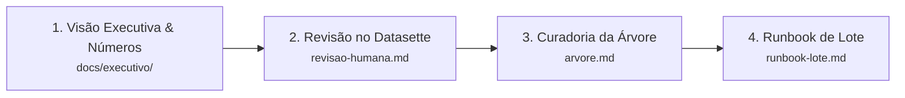
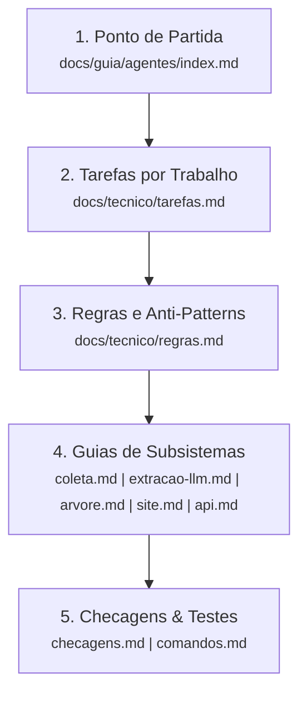
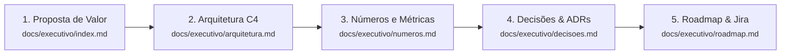

# Começando no projeto

Trilhas de leitura e primeiro contato com o projeto, estruturadas estritamente por perfil: dono e mantenedor do produto, agentes autônomos e desenvolvedores, e visitantes ou stakeholders executivos.

**Para que serve:** Guiar a navegação inicial e o entendimento rápido do projeto conforme o papel ou objetivo do leitor. **Quando ler:** Na primeira vez que interagir com o projeto ou ao assumir um novo perfil de trabalho ou tarefa técnica.

-   :material-crown: **[Perfil Dono e Mantenedor](#perfil-dono)**

    ---

    Supervisão de integridade, operação de novos lotes, aprovação humana de editais e curadoria da árvore mestre.

-   :material-robot: **[Perfil Agente e Desenvolvedor](#perfil-agente)**

    ---

    Desenvolvimento seguro guiado por tarefas e regras do núcleo, subsistemas técnicos, checagens e testes.

-   :material-chart-box-outline: **[Perfil Visitante Executivo](#perfil-visitante)**

    ---

    Visão de produto, modelo arquitetural C4, métricas de engenharia, catálogo de ADRs e roadmap de entregas.

---

## 1. Perfil Dono / Mantenedor do Produto {#perfil-dono}

O dono e mantenedor do produto atua como a autoridade central de governança dos dados, responsável por acompanhar a integridade do acervo, coordenar o avanço de novos lotes de certames, homologar o conteúdo extraído por inteligência artificial e curar a taxonomia de disciplinas.

### Objetivo do perfil
Compreender a saúde global do sistema, executar com previsibilidade a ingestão de novos lotes de concursos, validar e aprovar revisões humanas e exercer a curadoria soberana da árvore taxonômica mestre.

### Trilha de leitura recomendada

1. **Visão executiva e números canônicos:**
   A porta de entrada do mantenedor apresenta o resumo do problema, a estrutura do ecossistema e os números canônicos extraídos diretamente do banco PostgreSQL de produção (`scraper-cebraspe-db`). A consulta deve ser feita em [Visão executiva](../executivo/index.md) e [Números consolidados](../executivo/numeros.md), que monitoram o total de concursos carregados, concursos homologados pelo dono, cadernos e apontamentos na árvore sem dispersão de métricas manuais.
   Fonte: docs/executivo/index.md:5-28, docs/executivo/numeros.md:22-54

2. **Revisão no Datasette e portões humanos:**
   A homologação de editais processados por modelos de linguagem é detalhada em [Revisão humana e portões](revisao-humana.md). O processo combina a navegação na base SQLite em `https://datasette.projetoathos.com.br` com a conferência de relatórios HTML de página única gerados em `revisao_piloto/relatorio/`. A aprovação formal é registrada exclusivamente no corpo do arquivo `<edital>.json` por meio da chave `status_revisao_humana` iniciada pelo prefixo `APROVADO` ([P41](../tecnico/regras.md#p41)), sendo terminantemente proibido aprovar certames via comandos `UPDATE` manuais no banco relacional ([A25](../tecnico/regras.md#a25)), pois qualquer modificação externa é revertida pelo módulo `src/stats_writer.py`.
   Fonte: docs/guia/revisao-humana.md:10-20, 38-48; docs/adr/ADR-028-cargos-restritos-e-aprovacao-fase4.md:20-23

3. **Curadoria soberana da árvore mestre:**
   A gestão das disciplinas, assuntos e subassuntos canônicos está consolidada em [Árvore mestre e curadoria](arvore.md). O dono é a única entidade autorizada a aprovar a criação, fusão ou migração de nós propostos por LLMs ou regras determinísticas ([A30](../tecnico/regras.md#a30)). Todas as intervenções na árvore devem ser executadas com o script `scripts/curar_arvore.py` ([P51](../tecnico/regras.md#p51)), preservando a integridade referencial em `canonico/arvore.json` e prevenindo duplicidades conceituais.
   Fonte: docs/guia/arvore.md:8-25, 60-80; src/arvore.py:14-38

4. **Operação de lotes de concursos:**
   A operacionalização de novas cargas é orientada passo a passo pelo [Runbook de lote](../runbook-lote.md). O documento descreve a sequência encadeada dos passos P0 a P6 (backup de segurança, download de PDFs, chunking determinístico, extração de taxonomia, carga de cadernos, checagens de integridade e detecção de dispersão), acompanhada de tempos médios e limites orçamentários de tokens, garantindo que o piloto original de 2025 permaneça imutável ([P71](../tecnico/regras.md#p71)).
   Fonte: docs/runbook-lote.md:8-15, 36-48; docs/tecnico/regras.md:26-27

---

## 2. Perfil Agente Autônomo / Desenvolvedor {#perfil-agente}

O desenvolvedor de software ou agente autônomo opera diretamente sobre a base de código, os parsers, o banco de dados e as interfaces, devendo agir com extremo rigor para garantir idempotência, respeito a invariantes e preservação da arquitetura.

### Objetivo do perfil
Alterar código-fonte, rotinas de extração, consultas analíticas e componentes web com segurança, prevenindo regressões em certames históricos e cumprindo estritamente as convenções do projeto.

### Trilha de leitura recomendada

1. **Ponto de partida e contexto de tarefas:**
   Antes de iniciar qualquer intervenção técnica, o profissional deve acessar [Para agentes](agentes/index.md), que organiza o método de navegação eficiente e evita a leitura dispersa de código ou de documentos desnecessários.
   Fonte: docs/guia/agentes/index.md:3-6, 29-33

2. **Mapeamento de tarefas por tipo de trabalho:**
   Toda demanda deve ser localizada no catálogo [Tarefas](../tecnico/tarefas.md) (identificadores T01 a T12). Cada entrada lista exatamente as leituras preparatórias, as regras nucleares obrigatórias, as etapas do pipeline envolvidas, os scripts correspondentes e os critérios de validação para aquela atividade específica.
   Fonte: docs/tecnico/tarefas.md:5-39, 41-98, 126-179

3. **Regras do projeto e anti-patterns:**
   A obediência aos padrões arquiteturais registrados em [Regras do projeto](../tecnico/regras.md) é mandatória. As regras do núcleo — tais como a proibição de alterar à mão páginas de documentação técnica geradas de código ([A62](../tecnico/regras.md#a62)), a blindagem do piloto histórico de 2025 ([P71](../tecnico/regras.md#p71)) e o uso exclusivo de chaves de API dedicadas por etapa ([P17](../tecnico/regras.md#p17)) — protegem a base de dados contra corrupção silenciosa e divergências de schema.
   Fonte: docs/tecnico/regras.md:11-32; docs/guia/agentes/index.md:15-20

4. **Guias dos subsistemas do produto:**
   O desenvolvedor deve consultar o guia de referência do componente técnico que estiver manipulando:
   - [Coleta e download de arquivos](coleta.md): crawler Playwright com resolução determinística de URLs, filtros por slug e deduplicação de PDFs em duas camadas (URL e hash SHA-256).
     Fonte: docs/guia/coleta.md:8-30; src/spider.py:86-121; src/downloader.py:160-169
   - [Extração por LLM e observabilidade](extracao-llm.md): recorte da seção "OBJETOS DE AVALIAÇÃO", chunking em dois níveis (cargo e matéria), chamadas REST diretas ao OpenRouter (`z-ai/glm-5.3-flash`) e telemetria OTel via Langfuse SDK oficial.
     Fonte: docs/guia/extracao-llm.md:8-30; src/edital_parser.py:313-331; src/llm_openrouter.py:40-75
   - [Árvore mestre e curadoria](arvore.md): modelo dimensional de nós (`NoArvore`), representação JSON canônica e sincronização relacional em `no_arvore` e `dim_materia`.
     Fonte: docs/guia/arvore.md:8-35; src/arvore.py:14-38
   - [Site público](site.md): frontend web modular em FastAPI, Jinja2, HTMX e Alpine.js estruturado em três camadas (`repositorio/`, `servicos/`, `web/`) com compilação standalone de Tailwind CSS em tom teal.
     Fonte: docs/guia/site.md:8-30; docs/adr/ADR-033-site-publico-stack-e-deploy.md:36-60
   - [API do site](api.md): rotas sob `/api/v1`, contratos OpenAPI 3.1.0 e resolução de itens via chave composta imutável `<concurso>|<caderno>|<numero>`.
     Fonte: docs/guia/api.md:8-30; site/app/main.py:34-100
   - [Arquitetura do sistema](../architecture.md): topologia de contêineres Docker isolados, redes internas `homelab_default` e volumes persistentes do PostgreSQL.
     Fonte: docs/architecture.md:8-19, 29-50

5. **Checagens de integridade e comandos de execução:**
   Nenhum código é promovido sem validação empírica. O desenvolvedor deve executar os comandos catalogados em [Comandos](../tecnico/comandos.md) e comprovar conformidade nas checagens bloqueantes e informativas de [Checagens](../tecnico/checagens.md) (indicadores K01 a K33), além da suíte automatizada de testes (`pytest`).
   Fonte: docs/tecnico/checagens.md:3-6, 11-25; docs/tecnico/comandos.md:3-25

---

## 3. Perfil Visitante / Stakeholder Executivo {#perfil-visitante}

O visitante ou stakeholder avalia o projeto do ponto de vista de arquitetura de software, qualidade de engenharia de dados, maturidade de entrega e viabilidade operacional do produto.

### Objetivo do perfil
Avaliar a amplitude do escopo técnico, o rigor de engenharia na combinação de pipelines de dados e modelos de linguagem, a governança de custos e o estágio de maturidade das entregas do produto.

### Trilha de leitura recomendada

1. **Visão executiva e proposta de valor:**
   Apresentação clara do problema de fragmentação de editais e cadernos do CEBRASPE e como a plataforma unifica coleta determinística, extração semântica e resolução de questões orientada a incidência real em [Visão executiva](../executivo/index.md).
   Fonte: docs/executivo/index.md:5-28

2. **Arquitetura de alto nível (Modelo C4):**
   Compreensão dos diagramas de contexto e contêineres que evidenciam o isolamento dos subsistemas, o uso do PostgreSQL próprio em estrela (star schema) e as integrações externas com OpenRouter, Langfuse, Google OAuth e Cloudflare Tunnel sob Traefik em [Arquitetura executiva](../executivo/arquitetura.md).
   Fonte: docs/executivo/arquitetura.md:7-50

3. **Métricas e números consolidados:**
   Avaliação da volumetria real do acervo, detalhando cobertura histórica desde 2020, total de certames processados, cadernos e distribuição de questões entre certo/errado e múltipla escolha em [Números consolidados](../executivo/numeros.md).
   Fonte: docs/executivo/numeros.md:7-54

4. **Decisões de engenharia e registros de arquitetura (ADRs):**
   Exame dos fundamentos e trade-offs técnicos assumidos pelo projeto em [Decisões principais](../executivo/decisoes.md) e consulta ao acervo integral de registros em [Catálogo de ADRs](../adr/README.md), cobrindo desde estratégias de download até contratos de árvore e separação em camadas web.
   Fonte: docs/executivo/decisoes.md:3-50; docs/adr/README.md:1-40

5. **Roadmap de produto e entregas:**
   Acompanhamento do histórico de entregas concluídas (piloto 2025, simulador, portal web), da frente em desenvolvimento ativo (ingestão dos concursos de múltipla escolha sob KAN-55 e orquestração via Dagster sob KAN-31) e dos marcos estratégicos futuros em [Roadmap](../executivo/roadmap.md).
   Fonte: docs/executivo/roadmap.md:9-31

---

## 4. Matriz Comparativa das Trilhas {#matriz-comparativa}

A tabela a seguir sumariza as portas de entrada, as ferramentas operacionais e os critérios de validação para cada perfil:

| Dimensão | Perfil Dono / Mantenedor | Perfil Agente / Desenvolvedor | Perfil Visitante / Executivo |
|---|---|---|---|
| **Foco primordial** | Governança de dados, curadoria e avanço de lotes | Implementação de código, parsers e regras de integridade | Avaliação de escopo, robustez de engenharia e métricas |
| **Ponto de partida** | [Visão executiva](../executivo/index.md) e [Números](../executivo/numeros.md) | [Para agentes](agentes/index.md) e [Tarefas](../tecnico/tarefas.md) | [Visão executiva](../executivo/index.md) |
| **Documento central de trabalho** | [Runbook de lote](../runbook-lote.md) | [Regras do projeto](../tecnico/regras.md) e guias técnicos de subsistemas | [Arquitetura](../executivo/arquitetura.md) e [Decisões](../executivo/decisoes.md) |
| **Interfaces principais** | Datasette (`:8011`) e relatórios HTML de revisão | Terminal, Docker, PostgreSQL (`:5435`) e Git | Portal web de questões (`:8012`) e documentação (`:8013`) |
| **Comando / Ação rotineira** | `scripts.revisar_taxonomia_piloto`, `scripts.curar_arvore` | `pytest`, `ruff check .`, `scripts.gerar_docs` | Navegação em telas de estatísticas e leitura de ADRs |
| **Critério de sucesso** | Base homologada no JSON, zero alertas bloqueantes e piloto íntegro | Checagens K01–K33 verdes, testes passando e invariantes preservadas | Compreensão da proposta técnica, aderência aos padrões e governança |

---

## Referências e Regras Relacionadas

- Regra relacionada: [P41 - Aprovação no JSON do edital](../tecnico/regras.md#p41)
- Regra relacionada: [P51 - Decisão do dono na árvore via curar_arvore.py](../tecnico/regras.md#p51)
- Regra relacionada: [P71 - Invariante do piloto de 2025](../tecnico/regras.md#p71)
- Regra relacionada: [A25 - Proibição de aprovação via UPDATE no banco](../tecnico/regras.md#a25)
- Regra relacionada: [A30 - Aprovação de propostas de LLM exclusiva do dono](../tecnico/regras.md#a30)
- Regra relacionada: [A62 - Páginas técnicas geradas a partir do registro](../tecnico/regras.md#a62)
- Decisão de arquitetura: [ADR-015 - Revisão Navegável via Datasette e Traefik](../adr/ADR-015-revisao-datasette-traefik.md)
- Decisão de arquitetura: [ADR-028 - Cargos Restritos e Aprovação da Fase 4](../adr/ADR-028-cargos-restritos-e-aprovacao-fase4.md)
- Decisão de arquitetura: [ADR-030 - Árvore Mestre e Site de Questões](../adr/ADR-030-arvore-mestre-e-site-de-questoes.md)
- Decisão de arquitetura: [ADR-033 - Site Público: Stack, SSR e Deploy](../adr/ADR-033-site-publico-stack-e-deploy.md)
- Decisão de arquitetura: [ADR-041 - Registro Técnico em Python e Geração de Documentação](../adr/ADR-041-registro-e-paginas-geradas.md)

---
_Verificado em 2026-10-21 contra commit 6a9e448._
