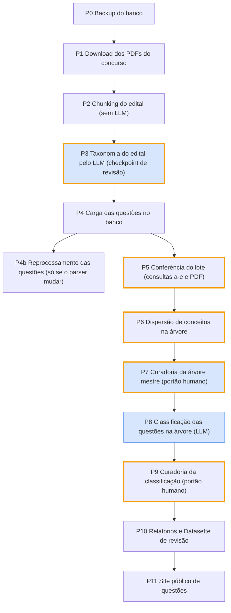

<!-- Gerado por scripts/gerar_docs.py a partir de src/registro/. Não editar à mão: rode `make docs-gerar`. -->

# Pipeline

Etapas do pipeline e suas dependências (`depois_de`), geradas do registro. Borda laranja grossa: portão humano, o dono aprova antes da próxima etapa. Fundo azul: etapa que usa LLM.



## P0 Backup do banco

```bash
docker exec scraper-cebraspe-db pg_dump -U cebraspe -d cebraspe -Fc > scratch/backup_<data>_<sessao>.dump
```

**Scripts:** nenhum

**Depende de:** nenhuma (início do pipeline)

**LLM:** não usa

**Portão humano:** nenhum

**ADRs:** nenhuma

**Entradas:**

- banco cebraspe (scraper-cebraspe-db)

**Saídas:**

- scratch/backup_<data>_<sessao>.dump

**Notas:** Runbook §4.1. Conferir com pg_restore -l (95 TABLE DATA no lote de calibração); zero ou erro = não seguir.

## P1 Download dos PDFs do concurso

```bash
venv/bin/python -m src.spider --slug <SLUG>
```

**Scripts:** `src.spider`

**Depende de:** P0

**LLM:** não usa

**Portão humano:** nenhum

**ADRs:** [ADR-037](../adr/ADR-037-escopo-do-site-no-inventario.md)

**Entradas:**

- site do CEBRASPE (concurso encerrado)
- inventario/concursos.jsonl (contagens esperadas)

**Saídas:**

- data/<ano>/CEBRASPE/<ORGAO>/Editais/*.pdf
- data/<ano>/CEBRASPE/<ORGAO>/Provas/*.pdf
- data/<ano>/CEBRASPE/<ORGAO>/Gabaritos/*.pdf
- data/<ano>/CEBRASPE/<ORGAO>/.manifest.json
- data/<ano>/CEBRASPE/<ORGAO>/provas_texto_link.json

**Notas:** Runbook §4.2. Um comando por concurso. Todo PDF começa com %PDF-.

## P2 Chunking do edital (sem LLM)

```bash
venv/bin/python - <edital_extracao.pdf>  # trecho do runbook §4.3, sem comando próprio no projeto
```

**Scripts:** nenhum

**Depende de:** P1

**LLM:** não usa

**Portão humano:** nenhum

**ADRs:** nenhuma

**Entradas:**

- data/<ano>/CEBRASPE/<ORGAO>/Editais/<edital_extracao>.pdf

**Saídas:**

- saída na tela (sem gravação)

**Notas:** Gate de custo zero: chunk de 1 a 40 caracteres, nível None ou matéria que é nome de cargo barram o P3. Pendência da C2: comando próprio.

## P3 Taxonomia do edital pelo LLM (checkpoint de revisão)

```bash
venv/bin/python -m scripts.revisar_taxonomia_piloto data/<ano>/CEBRASPE/<ORGAO>/Editais/<edital_extracao>.pdf
```

**Scripts:** `scripts.revisar_taxonomia_piloto`

**Depende de:** P2

**LLM:** `OpenRouter, modelo z-ai/glm-5.3-flash, chave OPENROUTER_KEY_TAXONOMIA_EDITAL (trace cebraspe-4-taxonomia-edital)`

**Portão humano:** Dono aprova cada edital no Datasette (relatorio/index.html), gravando status_revisao_humana = 'APROVADO...' no JSON. O agente nunca aprova (ADR-028). Antes disso o concurso fica pendente.

**ADRs:** [ADR-025](../adr/ADR-025-reconciliacao-deterministica-severidade-alertas.md), [ADR-028](../adr/ADR-028-cargos-restritos-e-aprovacao-fase4.md)

**Entradas:**

- data/<ano>/CEBRASPE/<ORGAO>/Editais/<edital_extracao>.pdf

**Saídas:**

- revisao_piloto/<edital>.json
- revisao_piloto/<edital>.auditoria.json
- revisao_piloto/<edital>.validacao.json
- artefatos de revisão (relatórios e Datasette, via atualizar_revisao)

**Notas:** Runbook §4.4. Falhas > 0 = reprocessar_falhas_piloto; alerta > 0 = ler o .validacao.json. Ao final chama atualizar_revisao, que também faz a carga do banco (P4) e a regra da árvore.

## P4 Carga das questões no banco

```bash
venv/bin/python -m src.stats_writer
venv/bin/python -m scripts.extrair_questoes
venv/bin/python -m scripts.extrair_questoes --reprocessar-erros
```

**Scripts:** `src.stats_writer`, `scripts.extrair_questoes`

**Depende de:** P3

**LLM:** não usa

**Portão humano:** nenhum

**ADRs:** nenhuma

**Entradas:**

- revisao_piloto/<edital>.json
- data/<ano>/CEBRASPE/<ORGAO>/Provas/*.pdf
- data/<ano>/CEBRASPE/<ORGAO>/Gabaritos/*.pdf
- tabela fila_extracao_questoes

**Saídas:**

- tabela provas
- tabela provas_cargos
- tabela textos_base
- tabela questoes
- tabela discursivas
- questoes/<caderno>.json
- questoes/<caderno>.auditoria.json

**Notas:** Runbook §4.4 (P4 sai do P3). Lock pg_try_advisory_lock(5031001): se outro processo roda, sai sem fazer nada.

## P4b Reprocessamento das questões (só se o parser mudar)

```bash
venv/bin/python -m scripts.extrair_questoes --reprocessar
```

**Scripts:** `scripts.extrair_questoes`

**Depende de:** P4

**LLM:** não usa

**Portão humano:** nenhum

**ADRs:** nenhuma

**Entradas:**

- data/<ano>/CEBRASPE/<ORGAO>/Provas/*.pdf
- tabela fila_extracao_questoes

**Saídas:**

- tabela questoes
- tabela discursivas
- questoes/<caderno>.json

**Notas:** Runbook §3 e §4.2 (P4b). Snapshot antes e depois: o piloto tem que ficar idêntico, com só a mudança esperada.

## P5 Conferência do lote (consultas a-e e PDF)

```bash
docker exec scraper-cebraspe-db psql -U cebraspe -d cebraspe
```

**Scripts:** nenhum

**Depende de:** P4

**LLM:** não usa

**Portão humano:** Consultas a-e conferidas e 3 questões iguais ao PDF. Invariante do piloto inalterado: 2800 itens, 129 anuladas, 3029 apontamentos.

**ADRs:** [ADR-031](../adr/ADR-031-extracao-questoes-cadernos.md)

**Entradas:**

- tabela provas
- tabela questoes
- tabela discursivas
- tabela fila_extracao_questoes
- view vw_questoes

**Saídas:**

- nenhuma (só leitura)

**Notas:** Runbook §4.5. Sem LLM. Consulta d (seções por caderno) e a de alternativa terminando em caixa alta pegam o defeito de cabeçalho de matéria.

## P6 Dispersão de conceitos na árvore

```bash
venv/bin/python -m scripts.detectar_dispersao_arvore --dry-run
venv/bin/python -m scripts.detectar_dispersao_arvore --propor
```

**Scripts:** `scripts.detectar_dispersao_arvore`

**Depende de:** P5

**LLM:** não usa

**Portão humano:** Dono aprova ou rejeita cada grupo de propostas do detector (curar_arvore --aprovar-proposta / --rejeitar-proposta), nunca em bloco. Norma em dois lugares vira proposta, não fusão do agente.

**ADRs:** [ADR-030](../adr/ADR-030-arvore-mestre-e-site-de-questoes.md)

**Entradas:**

- canonico/arvore.json

**Saídas:**

- propostas pendentes em canonico/arvore.json
- docs/relatorios/dispersao_arvore_<data>.md (--dry-run padrão)

**Notas:** Runbook §4.6 (KAN-64). Custo zero. O detector erra às vezes, então cada grupo é uma decisão.

## P7 Curadoria da árvore mestre (portão humano)

```bash
venv/bin/python -m scripts.propor_arvore --dry-run
venv/bin/python -m scripts.propor_arvore
venv/bin/python -m scripts.curar_arvore --html
venv/bin/python -m scripts.curar_arvore --aprovar-proposta <ids>
venv/bin/python -m scripts.curar_arvore --rejeitar-proposta <ids>
```

**Scripts:** `scripts.propor_arvore`, `scripts.curar_arvore`

**Depende de:** P6

**LLM:** `OpenRouter, modelo z-ai/glm-5.3-flash, chave OPENROUTER_KEY_CURADORIA_ARVORE (trace cebraspe-5b2-curadoria-arvore; só o propor_arvore chama o LLM)`

**Portão humano:** Pendências da árvore resolvidas pelo dono: itens de edital sem nó, mapeamentos e nós propostos. Só depois disso a classificação roda.

**ADRs:** [ADR-030](../adr/ADR-030-arvore-mestre-e-site-de-questoes.md)

**Entradas:**

- canonico/arvore.json

**Saídas:**

- canonico/arvore.json
- revisao_piloto/relatorio/arvore.html

**Notas:** task.md, Etapa 8.C, C1b (KAN-57): 'árvore (pausa: curadoria)'. Aprovação sempre humana.

## P8 Classificação das questões na árvore (LLM)

```bash
venv/bin/python -m scripts.classificar_questoes --dry-run
venv/bin/python -m scripts.classificar_questoes [--caderno CODIGO] [--limite N]
```

**Scripts:** `scripts.classificar_questoes`

**Depende de:** P7

**LLM:** `OpenRouter, modelo z-ai/glm-5.3-flash, chave OPENROUTER_KEY_CLASSIFICACAO_QUESTOES (trace cebraspe-5d-classificacao-questoes)`

**Portão humano:** nenhum

**ADRs:** [ADR-032](../adr/ADR-032-classificacao-questoes-arvore.md)

**Entradas:**

- tabela questoes
- tabela discursivas
- canonico/arvore.json
- canonico/classificacao_questoes.json

**Saídas:**

- canonico/classificacao_questoes.json
- tabela questao_no (carga pelo stats_writer)
- tabela discursiva_no (carga pelo stats_writer)

**Notas:** task.md, Etapa 5D (sessão B) e C1b. Até 2 nós por questão; confiança alta, média ou baixa. Reexecução preserva classificações aprovadas.

## P9 Curadoria da classificação (portão humano)

```bash
venv/bin/python -m scripts.curar_classificacao --aprovar 'CHAVE:NO'
venv/bin/python -m scripts.curar_classificacao --mapear 'CHAVE:NO1[,NO2]'
```

**Scripts:** `scripts.curar_classificacao`

**Depende de:** P8

**LLM:** não usa

**Portão humano:** Dono decide a classificação de confiança média e baixa, e as questões sem nó. Pronto com 0 pendências (5D).

**ADRs:** [ADR-030](../adr/ADR-030-arvore-mestre-e-site-de-questoes.md), [ADR-032](../adr/ADR-032-classificacao-questoes-arvore.md)

**Entradas:**

- canonico/classificacao_questoes.json
- relatorio/classificacao.html

**Saídas:**

- canonico/classificacao_questoes.json

**Notas:** task.md, Etapa 5D (sessão C). Toda aprovação ou rejeição é comando explícito do dono.

## P10 Relatórios e Datasette de revisão

```bash
venv/bin/python -m scripts.atualizar_revisao
```

**Scripts:** `scripts.atualizar_revisao`

**Depende de:** P9

**LLM:** não usa

**Portão humano:** nenhum

**ADRs:** [ADR-015](../adr/ADR-015-revisao-datasette-traefik.md), [ADR-019](../adr/ADR-019-pipeline-automatico-artefatos-revisao.md)

**Entradas:**

- revisao_piloto/<edital>.json
- revisao_piloto/<edital>.auditoria.json
- canonico/arvore.json
- canonico/classificacao_questoes.json

**Saídas:**

- revisao_piloto/relatorio/*.html
- revisao_piloto/revisao.db

**Notas:** Mesmo comando que roda no fim do P3. Reinicia o container Datasette. Servido com SSO do Cloudflare (ADR-015).

## P11 Site público de questões

```bash
uvicorn app.main:app  # a partir do diretório site/
```

**Scripts:** nenhum

**Depende de:** P10

**LLM:** não usa

**Portão humano:** nenhum

**ADRs:** [ADR-033](../adr/ADR-033-site-publico-stack-e-deploy.md)

**Entradas:**

- view vw_questoes
- schema app (respostas do site)

**Saídas:**

- site público (/questoes, /q/<concurso>/<caderno>/<numero>)

**Notas:** task.md, Etapas 5F e 5H; conferência no Chromium headless (C1b). Fora de scripts/: o código fica em site/.
